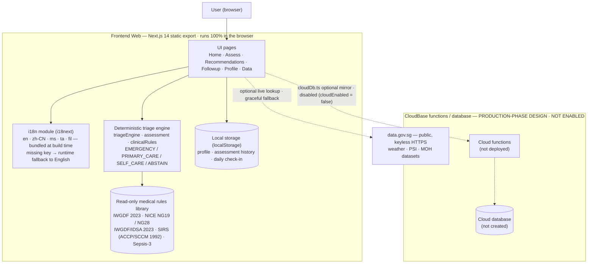

# System Architecture

**Project:** Diabetic Foot Check Assistant (FootCheck)
**Version:** v3.17 ｜ **Date:** 2026-10-14
**Diagram files:** [`system-architecture.mmd`](./system-architecture.mmd) (Mermaid source) · [`system-architecture.svg`](./system-architecture.svg) · [`system-architecture.png`](./system-architecture.png)

> **In one line:** a **pure front-end, offline-capable deterministic screening tool**. Clinical decisions are made by a **deterministic rule engine compiled into the bundle**; data lives only in the user's browser `localStorage` by default. The CloudBase cloud functions / database are a **production-phase design that is NOT enabled** (drawn with a dashed outline).

---

## 1. Diagram



<details>
<summary>Mermaid source (click to expand)</summary>



</details>

---

## 2. Component responsibilities

| Component | Code location | Responsibility | Network? |
| --- | --- | --- | --- |
| **UI pages** | `web/src/app/**/page.tsx` | Home / Assess / Recommendations / Followup / Profile / Data — 6 pages | No |
| **i18n module** | `web/src/lib/i18n.ts`, `public/locales/*.json` | 5 languages (en / zh-CN / ms / ta / fil); **all 5 bundles are compiled into the JS at build time**, so switching language needs no network; a missing key falls back to English | No |
| **Deterministic triage engine** | `triageEngine.ts`, `assessment.ts`, `clinicalRules.ts` | Maps answers to a care tier (EMERGENCY / PRIMARY_CARE / SELF_CARE / ABSTAIN), a risk level and an IWGDF category; **pure functions, auditable, language-independent** | No |
| **Read-only medical rules library** | same files (rule constants) | Thresholds and rules from IWGDF 2023 / NICE NG19 / NG28 / IWGDF‑IDSA 2023 / SIRS / Sepsis‑3, **compiled into the code and read-only** | No |
| **Local storage** | `assessment.ts` (localStorage) | Profile, assessment history and daily foot check-in — all stored **in the user's browser** | No |
| **External data (read-only)** | `dataSources.ts` | `data.gov.sg` public API (weather, PSI, MOH datasets), **keyless**; on failure it falls back to built-in data and never blocks the main flow | Yes (may fail) |
| **CloudBase (not enabled)** | `cloudDb.ts`, `cloud/schema.sql` | Production-phase synthetic-data mirror. Currently `cloudEnabled = false`, so `cloudDb` is a **no-op** | — |

---

## 3. Data flow (one full check)

```
User answers
  │  (collected by the UI, one question at a time)
  ▼
deriveTriageInput(answers, profile)   ← assessment.ts
  │
  ▼
evaluateTriage(input)                 ← triageEngine.ts (pure rules; first match wins)
  │  → tier: EMERGENCY | PRIMARY_CARE | SELF_CARE | ABSTAIN
  ▼
calculateRiskWithProfile(answers, profile)   ← assessment.ts
  │  → riskLevel + categoryScores + emergencyFlags
  ▼
mapToIWGDFCategory(result)            ← clinicalRules.ts
  │  → IWGDF category 0–3 → recommended screening interval
  ▼
UI renders (TriageCard + risk level + advice + IWGDF card)
  │
  ▼
localStorage persists (assessment history / profile / check-in)
```

**Key point:** the rule engine's inputs and outputs contain **no language information** and never call i18n. The engine emits only **translation keys and enum values** (e.g. `triage.playbook.EMERGENCY.actions.a1`, `SELF_CARE`), which the UI renders in the current language. Therefore the same answers produce **identical grading in all 5 languages** (guarded by `npm run test:crosslang`).

---

## 4. Why CloudBase is dashed (production-phase design, not enabled)

- The demo **does not upload data to a server** (privacy and PDPA — see `design-tradeoffs.md`), so the cloud is not required for the app to run.
- `cloudDb.ts` is an **optional enhancement**: it writes to the cloud only when the cloud is available, and falls back to a local mirror on failure — it **never blocks the main flow**.
- Cloud activation was attempted once in this environment and returned `cancelled` / `cloud_service_unavailable`, so `cloudEnabled` stays `false` and **no existing feature code was changed**.
- The CloudBase subgraph is drawn with a **dashed outline** to indicate a **production-phase design** (cloud functions + database + RLS) that is **not deployed and not created**.

---

## 5. Related documents

- Trust boundaries and security measures → [`trust-boundary.md`](./trust-boundary.md)
- Key design trade-offs → [`design-tradeoffs.md`](./design-tradeoffs.md)
- Data sources and grading standards → [`data-sources-and-grading-zh.md`](../中文说明/data-sources-and-grading-zh.md) (Chinese)
- Result-by-result mapping → [`assessment-criteria-source-mapping-zh.md`](../中文说明/assessment-criteria-source-mapping-zh.md) (Chinese)
