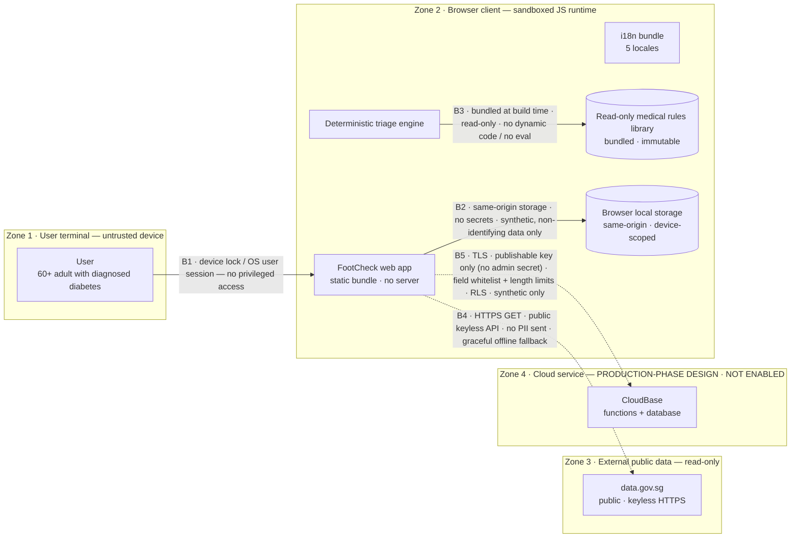

# Trust Boundaries

**Project:** Diabetic Foot Check Assistant (FootCheck)
**Version:** v3.17 ｜ **Date:** 2026-10-14
**Diagram files:** [`trust-boundary.mmd`](./trust-boundary.mmd) (Mermaid source) · [`trust-boundary.svg`](./trust-boundary.svg) · [`trust-boundary.png`](./trust-boundary.png)

> **In one line:** the demo has **no server-side trust boundary at all** — every clinical decision and every piece of personal data stays inside the user's own browser. The only external connection is the **public, keyless, read-only** `data.gov.sg`. The production-phase cloud boundary (Zone 4) is a design placeholder that is **not enabled** (dashed).

---

## 1. Diagram

Mermaid source (click to expand)

---

## 2. Trust zones

| Zone | Name | Trust level | Notes |
| --- | --- | --- | --- |
| **Zone 1** | User terminal | **Untrusted** | The user's own phone/computer, under the user's control |
| **Zone 2** | Browser client | **Trusted execution environment** | Sandboxed JS runtime; the app loads as a static bundle with no server |
| **Zone 3** | External public data | **Read-only, credential-free** | `data.gov.sg`, public API, receives no user data |
| **Zone 4** | Cloud service | **Production-phase design** | CloudBase functions/database; **not enabled** (dashed) |

---

## 3. Boundaries and security measures

| Boundary | Crosses | Security measures |
| --- | --- | --- |
| **B1** | Zone 1 → Zone 2 | Relies on the device lock / OS user session; the app **does not escalate privileges** and requests no privileged permissions; **no sign-up required** |
| **B2** | App → local storage | **Same-origin** restriction; stores **no secrets**; only **synthetic / non-identifying** fields (no name, NRIC, phone); data is **device-local and not synced** |
| **B3** | Engine → medical rules | Rules are **compiled into the code at build time** and **read-only**; no dynamic code loading, no `eval`; the rule engine is pure and **auditable** |
| **B4** | App → external data | **HTTPS GET** only; a public **keyless** API; **no PII is sent**; on failure it falls back to built-in data and **never blocks** the main flow |
| **B5** | App → cloud (not enabled) | **TLS**; the front end holds **only a publishable key** (no admin secret); writes use a **field whitelist + length limits**; server-side **RLS**; **synthetic data only**. Currently `cloudEnabled = false`, so this path is inactive |

---

## 4. Data flow and the "zero egress" guarantee

- **Nothing is sent out by default.** Answers, profile, assessment history and daily check-ins are written only to `localStorage` (B2) and **never cross the network**.
- **The only external request** is a **public read endpoint** on `data.gov.sg` (B4) — it carries only non-personal parameters such as an area name, used to show weather/PSI/population statistics. It **contains no user health data**.
- **No third-party analytics/tracking**: the build ships no analytics SDK.
- **The cloud path is off by default**: when `cloudEnabled = false`, `cloudDb.ts` **returns immediately and does nothing** — it does not even touch localStorage.

---

## 5. How this maps to Singapore's PDPA

| PDPA concern | How this project addresses it |
| --- | --- |
| Data minimisation | Collects only the fields the assessment needs; no free-text identity information |
| Purpose limitation | Data is used only for the local screening display; **not uploaded, not reused** |
| Cross-border transfer | **No transfer by default** (local storage only); any production cloud path would require a separate compliance review |
| Access and correction | Data lives on the user's device; the user can clear it via the browser |
| Retention and deletion | No server-side retention; clearing localStorage deletes it |

> ⚠️ This tool is for **screening and education**; it **gives no medication advice and does not replace professional medical care**. See the boundary statement in the root `README.md`.
