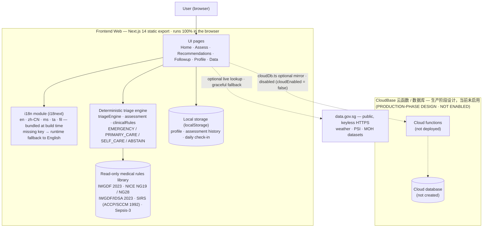

# 系统架构图 · System Architecture

**项目：** 糖尿病足检查助手（FootCheck）
**版本：** v3.16 ｜ **日期：** 2026-10-14
**图示文件：** [`system-architecture-zh.mmd`](./system-architecture-zh.mmd)（Mermaid 源）· [`system-architecture-zh.svg`](./system-architecture-zh.svg) · [`system-architecture-zh.png`](./system-architecture-zh.png)（导出图）

> **一句话：** 这是一个**纯前端、可在断网下运行的确定性筛查工具**。临床判定由**编译进包里的确定性规则引擎**完成，数据默认只存在用户浏览器的 localStorage；CloudBase 云函数/数据库为**生产阶段设计，当前未启用**（图中以虚线表示）。

---

## 1. 架构图



<details>
<summary>Mermaid 源（点击展开）</summary>



</details>

---

## 2. 组件职责

| 组件 | 代码位置 | 职责 | 是否联网 |
| --- | --- | --- | --- |
| **UI 页面** | `web/src/app/**/page.tsx` | 首页 / 评估 / 建议 / 追踪 / 个人资料 / 数据源，共 6 个页面 | 否 |
| **i18n 模块** | `web/src/lib/i18n.ts`、`public/locales/*.json` | 5 种语言（en / zh-CN / ms / ta / fil）；**5 份词条在构建时全部打进 JS**，切换语言不需要联网；运行时缺失 key 回退英文 | 否 |
| **确定性分诊引擎** | `triageEngine.ts`、`assessment.ts`、`clinicalRules.ts` | 把作答映射为就医层级（EMERGENCY / PRIMARY_CARE / SELF_CARE / ABSTAIN）、风险等级与 IWGDF 分级；**纯函数、可审计、与语言无关** | 否 |
| **只读医学规则库** | 同上（规则常量） | IWGDF 2023 / NICE NG19 / NG28 / IWGDF‑IDSA 2023 / SIRS / Sepsis‑3 的阈值与规则，**编译进代码、只读** | 否 |
| **本地存储** | `assessment.ts`（localStorage） | 个人资料、评估历史、每日足部打卡，全部存在**用户浏览器本地** | 否 |
| **外部数据（只读）** | `dataSources.ts` | `data.gov.sg` 公开 API（天气、PSI、MOH 数据集），**免密钥**；失败时自动回退到内置数据，不阻塞主流程 | 是（可失败） |
| **CloudBase（未启用）** | `cloudDb.ts`、`cloud/schema.sql` | 生产阶段的合成数据镜像。当前 `cloudEnabled = false`，`cloudDb` 在关闭时**直接空操作** | — |

---

## 3. 数据流（一次完整检查）

```
用户作答
  │  （UI 收集，逐题作答）
  ▼
deriveTriageInput(answers, profile)   ← assessment.ts
  │
  ▼
evaluateTriage(input)                 ← triageEngine.ts（纯规则，首个匹配即胜出）
  │  → tier: EMERGENCY | PRIMARY_CARE | SELF_CARE | ABSTAIN
  ▼
calculateRiskWithProfile(answers, profile)   ← assessment.ts
  │  → riskLevel + categoryScores + emergencyFlags
  ▼
mapToIWGDFCategory(result)            ← clinicalRules.ts
  │  → IWGDF 分级 0–3 → 建议筛查间隔
  ▼
UI 渲染（TriageCard + 风险等级 + 建议 + IWGDF 卡片）
  │
  ▼
localStorage 保存（评估历史 / 资料 / 打卡）
```

**关键点：** 规则引擎的输入输出**不含任何语言信息**，也不调用 i18n。引擎只产出**翻译 key 与枚举值**（如 `triage.playbook.EMERGENCY.actions.a1`、`SELF_CARE`），由 UI 层按当前语言渲染。因此同一组作答在 5 种语言下**分级结果完全一致**（由 `npm run test:crosslang` 守护）。

---

## 4. CloudBase 为何是虚线（生产阶段设计，当前未启用）

- 演示版**不把数据上传服务器**（隐私与 PDPA 考量，见 `design-tradeoffs-zh.md`），因此云端不是运行所需组件。
- `cloudDb.ts` 是**可选增强**：仅当云端可用时才写云，失败自动落回本地镜像，**绝不阻塞主流程**。
- 本环境曾尝试开通云端一次，返回 `cancelled` / `cloud_service_unavailable`，故保持 `cloudEnabled = false`，**未改动任何现有功能代码**。
- 图中 CloudBase 子图用**虚线**表示：它是**生产阶段的设计**（云函数 + 数据库 + RLS），当前**未部署、未建库**。

---

## 5. 相关文档

- 信任边界与安全措施 → [`trust-boundary.md`](../docs%20English%20version/trust-boundary.md)
- 关键设计取舍 → [`design-tradeoffs-zh.md`](./design-tradeoffs-zh.md)
- 数据源与分级标准 → [`data-sources-and-grading-zh.md`](./data-sources-and-grading-zh.md)
- 逐条「结果 ↔ 标准 ↔ 来源」对照 → [`assessment-criteria-source-mapping-zh.md`](./assessment-criteria-source-mapping-zh.md)
