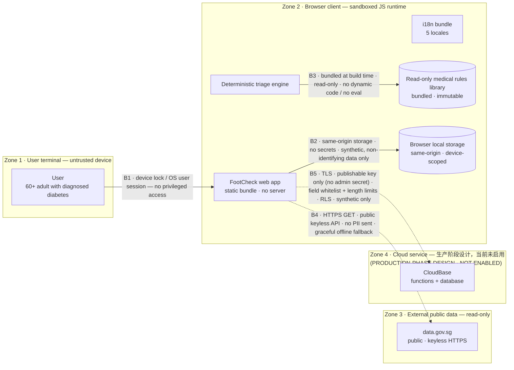

# 信任边界图 · Trust Boundaries

**项目：** 糖尿病足检查助手（FootCheck）
**版本：** v3.16 ｜ **日期：** 2026-10-14
**图示文件：** [`trust-boundary-zh.mmd`](./trust-boundary-zh.mmd)（Mermaid 源）· [`trust-boundary-zh.svg`](./trust-boundary-zh.svg) · [`trust-boundary-zh.png`](./trust-boundary-zh.png)（导出图）

> **一句话：** 演示版**没有任何服务端信任边界**——所有临床判定与个人数据都在用户自己的浏览器里完成；唯一的外部连接是**公开、免密钥、只读**的 `data.gov.sg`。生产阶段的云端边界（Zone 4）为设计预留，**当前未启用**（虚线）。

---

## 1. 信任边界图

Mermaid 源（点击展开）

---

## 2. 信任区域（Zones）

| 区域 | 名称 | 信任级别 | 说明 |
| --- | --- | --- | --- |
| **Zone 1** | 用户终端 | **不可信** | 用户自己的手机/电脑，属于用户控制的设备 |
| **Zone 2** | 浏览器客户端 | **可信执行环境** | 沙箱化的 JS 运行时；应用以静态包加载，无服务端 |
| **Zone 3** | 外部公开数据 | **只读、无凭证** | `data.gov.sg`，公开 API，不接收任何用户数据 |
| **Zone 4** | 云端服务 | **生产阶段设计** | CloudBase 云函数/数据库；**当前未启用**（虚线） |

---

## 3. 边界与安全措施（Boundaries）

| 边界 | 跨越 | 安全措施 |
| --- | --- | --- |
| **B1** | Zone 1 → Zone 2 | 依赖设备锁 / 操作系统用户会话；应用**不做提权**、不请求特权权限；无需注册即可使用 |
| **B2** | 应用 → 本地存储 | **同源（same-origin）**限制；不存储任何密钥；只存**合成 / 非身份识别**字段（无姓名、NRIC、电话）；数据**设备本地、不跨设备同步** |
| **B3** | 引擎 → 医学规则库 | 规则**在构建时打进代码**、**只读**；无动态代码加载、无 `eval`；规则引擎为纯函数，**可审计** |
| **B4** | 应用 → 外部数据 | 仅 **HTTPS GET**；公开**免密钥** API；**不发送任何 PII**；失败自动回退内置数据，**不阻塞**主流程 |
| **B5** | 应用 → 云端（未启用） | **TLS**；前端**只持有 publishable key**（无管理员密钥）；写入做**字段白名单 + 长度限制**；服务端 **RLS**；**仅合成数据**。当前 `cloudEnabled = false`，此路径不激活 |

---

## 4. 数据流向与「零外发」保证

- **默认不外发。** 用户作答、个人资料、评估历史、每日打卡 → 只写 `localStorage`（B2），**不经网络**。
- **唯一的外部请求**是 `data.gov.sg` 的**公开读接口**（B4）——请求里**只带区域名等非个人参数**，用于展示天气/PSI/人群统计，**不含用户健康数据**。
- **无第三方分析/追踪**：产物中不含任何分析 SDK。
- **云端路径默认关闭**：`cloudDb.ts` 在 `cloudEnabled = false` 时**直接返回、什么都不做**，连 localStorage 也不碰。

---

## 5. 与 PDPA（新加坡）的对应

| PDPA 关注点 | 本项目的做法 |
| --- | --- |
| 数据最小化 | 只采集评估所需字段；无自由文本身份信息 |
| 用途限制 | 数据仅用于本地筛查展示，**不上传、不二次利用** |
| 跨境传输 | 默认**不传输**（仅本地存储）；生产阶段如需云端，另做合规评估 |
| 访问与更正 | 数据在用户设备本地，用户可自行清除浏览器数据 |
| 保留与删除 | 无服务端留存；清除 localStorage 即删除 |

> ⚠️ 本工具是**筛查与教育**用途，**不提供用药建议、不替代专业医疗**。详见根目录 `README.md` 的边界声明。
